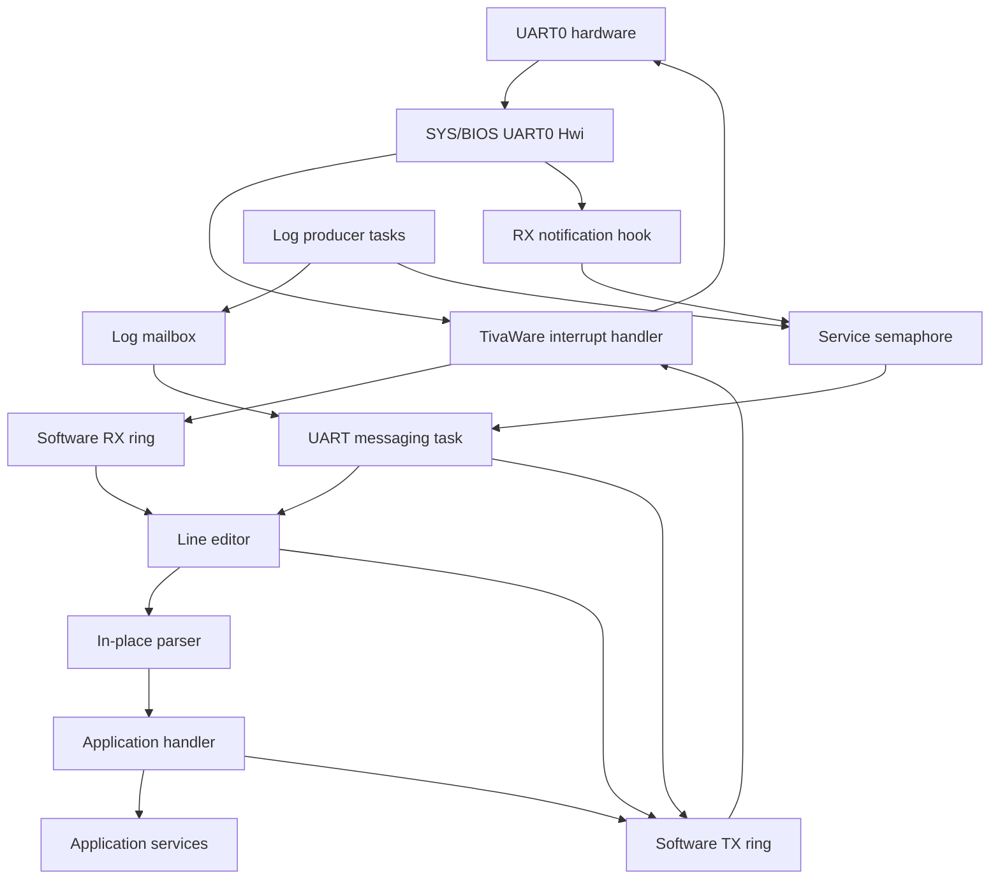

# UART console technical design

The console separates interrupt-driven UART transport, task-owned line editing,
in-place parsing, and application dispatch. The implementation resides in
`xCon/app/console`. Its scheduling and log transport reside in
`xCon/bsp/uart_interface.c`.

## Architecture and execution contexts

| Layer | Implementation | Responsibility | Execution context |
| --- | --- | --- | --- |
| UART hardware integration | `EK_TM4C129EXL_uart0ConsoleHwi()` | Service UART interrupts and signal received input | SYS/BIOS Hwi |
| Buffered transport | TivaWare `uartstdio` | Move bytes between hardware FIFOs and software rings | Hwi and calling task |
| Service coordination | `uart_messaging_service()` | Drain logs, process input, and wait for work | UART messaging task |
| Line editor | `console.c` | Own partial input, echo edits, and manage the prompt | UART messaging task |
| Parser | `CmdLineProcess()` in `cmdline.c` | Split input and locate a handler | UART messaging task |
| Application dispatch | `console_commands.c` | Define the registry and invoke application services | UART messaging task |

The Hwi handles transport work and wakes the service task. It does not edit
input or execute handlers. The service task owns the editor and invokes handlers
synchronously. There is no worker queue between parsing and handler execution.



The diagram shows data and notification paths. Semaphore posts signal work,
while the RX ring and mailbox hold the actual data.

## Initialization and service scheduling

Board initialization installs a SYS/BIOS Hwi wrapper before configuring UART0.
The build enables `UART_BUFFERED` for the TivaWare transport. UART0 is configured
for 115200 baud with eight data bits, no parity, and one stop bit.

`uart_log_init()` constructs a mailbox and a service semaphore before task
execution begins. The semaphore starts with a count of zero. The RX notification
hook checks that its handle exists before posting it.

On startup, `uart_messaging_service()` emits a banner and calls `console_init()`.
The editor clears its input length, disables transport-level echo, and emits the
initial prompt. The editor performs echo itself so that displayed input follows
its buffer state.

Each service iteration performs the following sequence.

1. Drain the log mailbox using nonblocking receives.
2. Restore the prompt if any log messages were written.
3. Call `console_poll()` to drain currently available RX bytes.
4. Wait indefinitely on the service semaphore.

The UART Hwi records interrupt status, calls `UARTStdioIntHandler()`, and posts
the service semaphore for receive or receive-timeout interrupts. A successful
log enqueue also posts the semaphore. Posting before the task reaches its wait
preserves a notification for the subsequent wait. The task determines pending
work from the mailbox and RX ring rather than from the semaphore count.

## Input call stack and dispatch flow

The interrupt and task paths are separate call stacks. The interrupt path ends
after updating the transport buffers and notifying the task.

```text
UART0 interrupt
  EK_TM4C129EXL_uart0ConsoleHwi()
    UARTIntStatus()
    UARTStdioIntHandler()
    uart_console_rx_isr_hook()       [receive or receive-timeout interrupt]
      Semaphore_post()
```

The task consumes the received bytes after it runs or resumes.

```text
uart_messaging_service()
  console_poll()
    UARTRxBytesAvail()
    UARTgetc()
    console_add_char()              [printable byte]
    console_backspace()             [erase byte]
    console_print_matches()         [Tab]
    console_run_command()           [line terminator]
      CmdLineProcess()
        registry lookup
        entry->pfnCmd(argc, argv)
          application service calls
      result reporting
      console_prompt()
  Semaphore_pend()
```

`console_poll()` checks that RX bytes are available before calling `UARTgetc()`.
It continues until the RX ring has no available bytes. Handler execution remains
on the UART task stack, so a slow or blocking handler delays both input
consumption and mailbox draining. Continuous log production can also delay input
because the service drains the mailbox before polling RX.

## Editor state and transitions

The editor stores a 96-byte static input array, a valid-byte count, and a
`prompt_visible` flag. The byte count defines the partial input. A terminating
NUL byte is only guaranteed when a line is submitted for parsing.

| Event | State transition | Output action |
| --- | --- | --- |
| Printable ASCII byte | Append the byte if fewer than 95 bytes are stored | Echo the accepted byte |
| Input capacity reached | Preserve the existing buffer and length | Emit a bell |
| Backspace or DEL | Decrement the length if it is nonzero | Erase the last displayed character |
| Tab | Preserve the input buffer and length | List registry prefix matches and redraw the input |
| CR or LF | Terminate and dispatch a nonempty line, then reset its length | Report the result and emit the prompt |
| Other byte | Preserve editor state | Produce no output |

CR and LF each trigger submission independently. There is no CRLF coalescing.
An input length of zero bypasses parsing. A nonempty line containing only spaces
reaches the parser and produces a lookup failure.

The editor has no cursor position or history state. It appends and removes bytes
only at the end of the line. It does not decode terminal escape sequences or
maintain a separate concealed-input mode.

## Parser and registry contracts

`CmdLineProcess()` receives writable, NUL-terminated input and replaces literal
spaces with NUL bytes. It records token addresses in the static `g_ppcArgv`
array. Repeated spaces do not create empty tokens. Quoting and escaping have no
special meaning.

`CMDLINE_MAX_ARGS` defaults to eight tokens, including the command name. The
parser returns immediately if another token would exceed that limit. The array
has an extra pointer slot, but the parser does not establish a NULL terminator
at `argv[argc]`. Handlers must use `argc` to determine the number of tokens.

Tokens refer directly to the editor buffer. They remain valid during the
synchronous handler call and must not be retained for later use. The parser
mutates that buffer, and subsequent editing reuses it.

`g_psCmdTable` is a static registry of `tCmdLineEntry` records. Each record
contains a command name, an `int (*)(int, char *[])` callback, and a brief help
string. A record with a NULL name terminates the table. Dispatch performs a
linear, case-sensitive exact comparison against the first token.

The same registry supplies metadata for command discovery. The editor scans
entries using the input prefix before the first literal space. It writes
matching names and descriptions without changing the input. There is no
separate completion index or argument-completion provider.

The parser returns the callback result directly. The editor interprets zero as
success, recognizes the four `CMDLINE_*` error values, and formats other results
as numeric failures. Parser and application errors share one integer namespace.
A subsystem error that equals a reserved parser value receives the same generic
diagnostic as that parser error.

## Output call stacks and prompt restoration

Formatted console output uses a bounded buffer on the calling task's stack.

```text
application handler or editor
  console_printf()
    console_vprintf()
      vsnprintf()
      console_write()
        UARTwrite()
          software TX ring
            UART interrupt handler
              hardware TX FIFO
```

`console_puts()` bypasses formatting and forwards the string through
`console_write()`. Neither path adds a newline. Console formatting uses a
256-byte local buffer and writes at most 255 bytes. Empty or failed formatting
produces no write. Console code does not inspect the number of bytes accepted by
`UARTwrite()` or retry a short write.

Background producers follow a separate path that converges in the service task.

```text
producer task
  uart_log()
    vsnprintf()
    Mailbox_post(BIOS_NO_WAIT)
    Semaphore_post()                [successful enqueue]

UART messaging task
  Mailbox_pend(BIOS_NO_WAIT)
  console_before_async_output()     [first message in a batch]
  UARTwrite()                      [each queued message]
  console_after_async_output()      [after the batch]
```

Before a log batch, the task moves output off the visible prompt and sets
`prompt_visible` to false. After the batch, it emits the prompt, marks it visible,
and writes the preserved partial input using its byte count. This restores the
display without changing the editor buffer. Log messages must supply their own
line endings because restoration does not ensure that the final message ended
on a fresh line.

These hooks coordinate display state within the owning task. They do not lock
the UART against unrelated writers. Fatal logging intentionally bypasses the
mailbox and software TX ring through polled hardware writes. Direct C-library
or transport output also lies outside the editor's prompt coordination.

## Memory, concurrency, and capacity

| Resource | Allocation and lifetime |
| --- | --- |
| Editor input | A static 96-byte array reused for successive lines |
| Editor state | A static byte count and prompt visibility flag |
| Parser tokens | A static array of `CMDLINE_MAX_ARGS + 1` pointers |
| Console formatting | A 256-byte local array for each active `console_vprintf()` call |
| Command registry | An application-defined global array terminated by a NULL name |
| Log queue | A SYS/BIOS mailbox with capacity for 16 fixed-size messages |
| Transport buffering | RX and TX rings managed by buffered TivaWare `uartstdio` |

The editor and parser do not allocate memory dynamically. Their static state
prevents concurrent or nested use. The mailbox serializes normal log delivery,
while the UART task provides exclusive ownership of editor operations.

`uart_log()` formats a complete message in the producer context and posts it
with `BIOS_NO_WAIT`. A full mailbox drops the new message rather than blocking
the producer. Formatting is bounded by `UART_LOG_MSG_LEN`. The console provides
no end-to-end delivery acknowledgement or retry mechanism.

Handler stack usage is added to the UART task's existing service, editor, and
parser frames. Formatted output adds its local buffer while those frames remain
active. The 256-byte formatting buffer is therefore only one contribution to
the required task stack size, not a bound on total stack consumption.

See [UART retargeting and logging](../uart-console-retarget.md) for the board
transport setup and C-library output integration.
